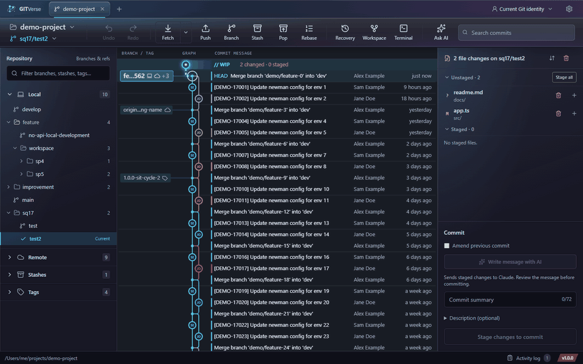
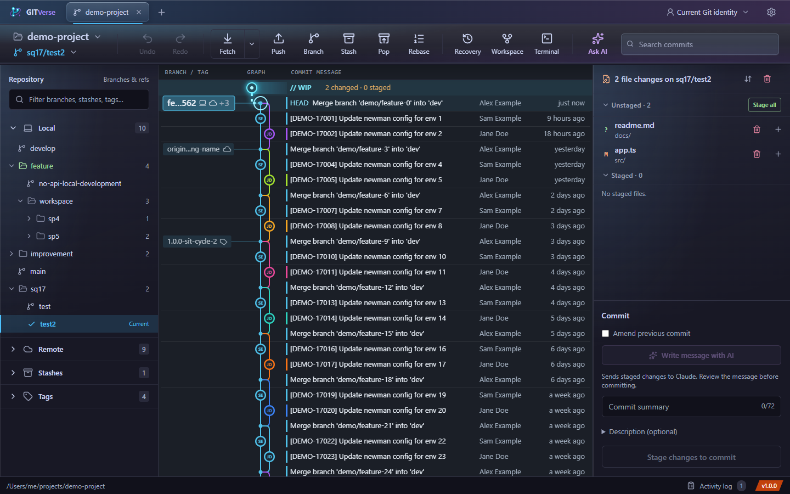
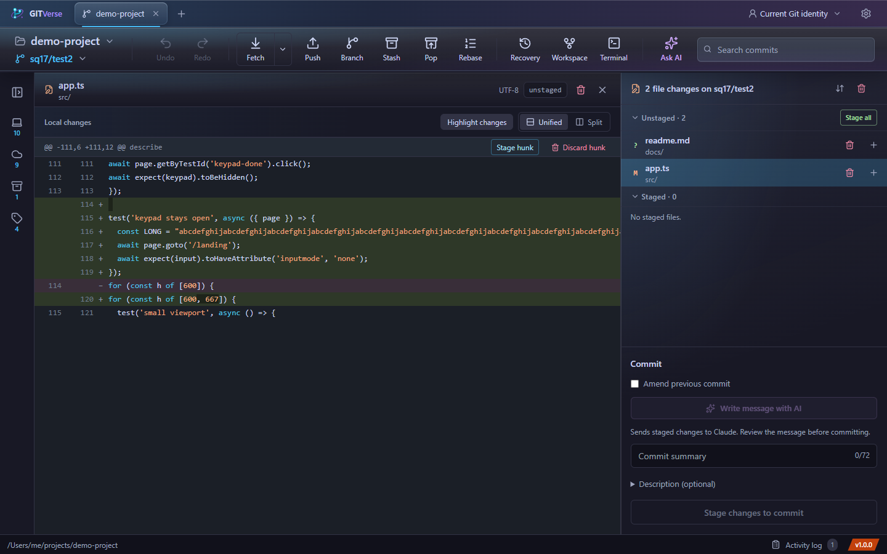

<div align="center">


### Your Git history, as a universe you can actually navigate.

A fast, beautiful desktop Git client with an interactive commit graph, painless conflict tools, an integrated terminal, and **optional** AI help that you control.

[](https://github.com/prapawity/GITVerse-by-PRAPAWITY/actions/workflows/ci.yml)
[](https://github.com/prapawity/GITVerse-by-PRAPAWITY/releases/latest)
[](./LICENSE)


[**Download**](#download) · [**Features**](#why-gitverse-by-prapawity) · [**AI & privacy**](#ai-and-privacy) · [**Contribute**](./CONTRIBUTING.md)

<br />



<sub>Review a change, stage it, then open a commit and switch its diff to split view. Recorded from the UI preview with demo data.</sub>

</div>

> **Status: experimental.** Back up important work before using operations that change history or the working tree. Cross-platform packaging is configured but every platform must be smoke-tested before publication.
>
> **Electron and Tauri.** Electron remains the default development and local build runtime. The shared UI also runs on [Tauri 2](https://tauri.app) with a Rust backend; the current tagged-release workflow builds Tauri installers and signed updater bundles. See the [Tauri build](#tauri-preview-build), [release process](./RELEASING.md), and [migration plan](./docs/rust-migration/migration-plan.md).

## Why GITVerse by PRAPAWITY?

|                                                  |                                                                                                                        |
| ------------------------------------------------ | ---------------------------------------------------------------------------------------------------------------------- |
| 🌌 **A graph you can read**                      | Local branches, remotes, tags, HEAD, and stashes in one colour-coded lane view, with search and paginated history.     |
| ⚡ **Everyday Git, one click away**              | Stage, commit, amend, fetch, pull, push, branch, stash, undo/redo from a clean toolbar.                                |
| 🧩 **Conflicts without the dread**               | A dedicated merge/conflict workflow with a built-in merge tool.                                                        |
| 🤖 **AI when you want it, never when you don't** | Bring your own Claude, OpenAI, or GitHub Copilot account for commit messages, conflict help, and chat. Off by default. |
| 🧑‍💻 **Built for real-world setups**               | Repository tabs and groups, multiple commit identities, per-repo push auth, Git Flow support, integrated terminal.     |
| 🔒 **Private by design**                         | No repo content leaves your machine unless you use an AI feature. Secrets stay in your OS's secure storage.            |

<p align="center">
  
  
</p>
<p align="center"><sub>Screenshots use the browser preview with demo data, not a real repository.</sub></p>

## Quick start

1. Grab the installer from [Releases](https://github.com/prapawity/GITVerse-by-PRAPAWITY/releases/latest) (see [Download](#download)).
2. Make sure [Git](https://git-scm.com/downloads) is installed.
3. Open GITVerse by PRAPAWITY and **drop a folder** onto the window. It scans for repositories, or clone one from the **+** tab.

Prefer to run from source?

```bash
git clone https://github.com/prapawity/GITVerse-by-PRAPAWITY.git
cd GITVerse-by-PRAPAWITY && npm ci && npm run dev
```

## Brand

The **Ringed Planet** identity pairs a warm peach planet with two orbiting rings — sky-blue `accent` and lavender `ai` from the app theme — that stand in for parallel branches, with commit nodes riding the rings. Vector sources: [symbol](./src/assets/gitverse-mark.svg) and [wordmark](./src/assets/gitverse-logo.svg). Open the [brand preview](./preview/brand.html) to inspect light/dark backgrounds and 16-64 px sizes.

## Feature details

- Repository tabs, groups, local-folder discovery, and cloning.
- Commit graph, branch/ref navigation, search, and paginated history.
- Working changes, staging, commits, commit details, and diffs.
- Branches, tags, stashes, fetch/pull/push, and Git Flow configuration.
- Merge/conflict workflow and integrated terminal.
- Commit identity profiles and repository-specific push authentication.
- Optional Claude, OpenAI, and GitHub Copilot integrations.
- Stable-release checks against GitHub Releases, with in-app download and restart-to-install on supported packaged builds.
- Four themes (Dark, Midnight, Graphite, Light) built on shared colour tokens and one type scale; secondary text meets 4.5:1 contrast in each. **Settings > Appearance > Font size** offers Small (12 px), Medium (14 px, default), and Large (18 px) presets for application text and graph labels. Changes apply immediately and are remembered locally; previously saved custom sizes use the nearest preset. Terminal font size remains independent.

The toolbar keeps every action on one row from 1024 px: below 1400 px it shows icons only, with the label as a tooltip. Recovery, Workspace and Ask AI open in the right-hand panel one at a time, and Escape closes them. While a merge, rebase, cherry-pick or revert is in progress, commands that cannot run (Rebase, Reset, Cherry pick, the commit form) are disabled with the reason instead of failing.

In the commit history, Author and Date have separate labelled columns on the right, independent of message scrolling. Date shows relative time within 24 hours and a calendar date for older commits. Column settings toggle these columns and the optional SHA column. The selected row is highlighted in its lane colour, and long branch names are shortened in the middle so both the prefix and the distinguishing end stay visible. Image diffs offer Fit, 1×, 2×, 4× and 8× zoom on a checkerboard background, with before and after side by side.

Dropping folders searches for repositories without a folder-count or depth limit. The scan shows live progress and can be cancelled. Hidden folders, dependency/build directories, and directory symlinks are skipped. Unreadable folders or invalid repositories are reported; cancelling discards the interrupted folder's results and keeps already completed dropped folders.

Groups created from a scanned folder remember that source directory. Open a group and use its **Sync** icon to discover newly added repositories, or let it scan automatically when the group opens or the app regains focus/becomes visible. Sync adds only previously unknown repositories, keeps the current repository selected, and never fetches, pulls, removes missing entries, changes existing group assignments, or reopens repositories you closed. A spinning icon indicates an active scan; repeated requests for that group are ignored while it runs. Groups without a saved source directory cannot sync. Manual scan failures show a notification; automatic scan failures are recorded in Activity log.

The commit graph follows local branches, remotes, tags, and HEAD, with readonly stash nodes merged into the layout. All stash reflog entries are shown with amber stash badges and connected to their base commit using a dashed line; internal index/untracked stash commits are not added as separate graph nodes. Select a stash from the sidebar or graph to see its hash, base parent, message, author/date, and Path/Tree file list while keeping the graph visible. Stash names can be set when creating a stash and edited from its detail field; renaming moves that stash to the top of the stash list. Selecting a file opens its readonly unified/split diff or file snapshot, including saved untracked files. Stash selection uses the object hash so reflog renumbering cannot switch the displayed content; a removed stash closes the selection on refresh. Stash nodes are excluded from branch context actions, and branch-history pagination is unchanged. Agent recovery refs under `refs/agents/` appear in a separate, collapsible **Agent checkpoints** panel, not as actionable branch commits. They are still Git objects used by the coding agent for recovery; GITVerse by PRAPAWITY does not delete them. Normal branch pushes do not publish stash objects or agent refs.

The Fetch toolbar menu remembers one of four actions for its main button: **Fetch All**, **Pull (fast-forward if possible)**, **Pull (fast-forward only)**, or **Pull (rebase)**. Fetch pruning follows the Auto-Prune setting. While the app is visible, repository status, refs, and operation state are checked every five seconds and when returning to the app. Changes made in a terminal or another Git client reload history with a notification. In-app pushes fetch remote refs afterward; a failed follow-up fetch is reported separately from a successful push. The WIP row shows changed and staged file counts with a cyan neon highlight; committing consumes staged changes, creates a history entry, and leaves any remaining changes in WIP.

Working Changes provides red trash buttons for one file or the selected files; with no selection, the top trash button discards all unstaged/untracked files. Click blank list space to clear the selection. Sort each group by **A-Z**, **Z-A**, **Most changes**, or **Fewest changes**; change counts are added plus deleted lines, counted separately for staged and unstaged content, with binary files last in count-based sorts. Shift-click selects a range in the displayed order; Ctrl/Cmd-click toggles individual files. The list refreshes automatically without a dedicated Refresh button. Discard requires confirmation, restores tracked files from the index, and permanently deletes selected untracked files without affecting staged content. Unstage staged-only changes before discarding them. In an unstaged text diff, **Discard hunk** removes only that change group and refreshes the detail view; added/deleted files, binary files, renames, and mode changes use whole-file discard instead. Discard rejects changed snapshots, conflicts, active Git operations, and whole-submodule/directory deletion. There is no app undo for discard; batches are not transactional if a Git/filesystem failure occurs during execution, so review the refreshed changes after an error.

Open the sort icon in the Working Changes header to choose a sorting mode from a compact menu. The current mode is checked and shown in the icon tooltip; selecting a mode, clicking outside, or pressing Escape closes the menu. Arrow keys navigate the choices without adding a permanent toolbar row.

The commit form does not offer sign-off or append `Signed-off-by` automatically; repositories requiring that trailer can include it in the description. Sign-off is a contributor certification, not a cryptographic signature. The footer shows the repository directory on the left and **Activity log** followed by an orange slanted app-version badge on the right, with the activity popup opening above the right edge. The badge reads the version from package metadata and updates with the app build.

Select **Amend previous commit** to update the latest commit instead of creating a new one. Its summary and description immediately replace the current draft with the latest commit message for editing, without a confirmation dialog. Leave both message fields blank to keep its existing summary and description, or enter a summary and optional description to replace the message. Amend can run without staged files. It rewrites the commit; if already pushed, updating the remote may require a force push.

The Push dialog offers **Force push (--force-with-lease)** for intentionally rewritten history. Selecting it shows a warning in the same dialog; **Confirm force push** sends the push without opening another modal. A non-fast-forward rejection also shows this option instead of retrying automatically. The lease uses the remote-tracking hash captured when the dialog opened: if the remote changes, the push is rejected, even if a background fetch updates local refs. If the remote hash is unavailable or the lease is stale, fetch and review the remote branch, then reopen the dialog. Force push may remove remote-only commits; server-side branch protections still apply.

## Download

Download the latest published installer from [GitHub Releases](https://github.com/prapawity/GITVerse-by-PRAPAWITY/releases/latest). Choose the file for your OS and CPU below; draft releases are not downloadable from the latest-release page.

| Platform            | Package                                   |
| ------------------- | ----------------------------------------- |
| macOS Apple Silicon | `mac-arm64.dmg` or `mac-arm64.zip` suffix |
| macOS Intel         | `mac-x64.dmg` or `mac-x64.zip` suffix     |
| Windows x64         | `win-x64.exe` suffix                      |
| Linux x64           | `linux-x86_64.AppImage` suffix            |

On macOS, open the DMG and drag GITVerse by PRAPAWITY to Applications (or unzip the ZIP). On Windows, run the EXE installer. On Linux, make the AppImage executable (`chmod +x GITVerse-by-PRAPAWITY-*.AppImage`) and launch it; AppImage support may require FUSE or extraction on your distribution.

Initial releases are unsigned and not notarized. macOS Gatekeeper and Windows SmartScreen may warn or block installation. Only install artifacts you trust; do not disable system-wide security protections.

Git must be installed separately and available to the app through `PATH`. Quit GITVerse by PRAPAWITY before replacing/upgrading an installation.

### Tauri preview build

The Tauri build has the same interface on a Rust backend and uses the system web view instead of a bundled Chromium. The release workflow creates a draft release on version tags when signed updater bundles are available. For build artifacts, open [Actions → Release](https://github.com/prapawity/GITVerse-by-PRAPAWITY/actions/workflows/release-tauri.yml), pick a successful packaging run, and download the artifact for your platform:

| Artifact                     | Contents                          |
| ---------------------------- | --------------------------------- |
| `gitverse-tauri-windows-x64` | NSIS `.exe` and `.msi` installers |
| `gitverse-tauri-macos-arm64` | `.dmg` for Apple Silicon          |
| `gitverse-tauri-macos-x64`   | `.dmg` for Intel Macs             |
| `gitverse-tauri-linux-x64`   | `.AppImage` and `.deb`            |

- The installers include Node.js and the GitHub Copilot runtime, so Copilot works without a separate Node install. Git is still required.
- On first start, the Tauri build imports API keys, the ChatGPT sign-in, the Copilot token, and push tokens saved by the Electron build. It never overwrites values already in the keychain.
- macOS builds are ad-hoc signed, not notarized. For a trusted build, use macOS's **Open** confirmation if Gatekeeper warns. Do not disable system-wide security protections.
- Windows needs the WebView2 runtime, which Windows 10 and 11 normally include. Windows builds are not code-signed, so SmartScreen may warn.
- Updates use signed bundles and a `latest.json` feed on GitHub Releases, published by the release workflow on version tags. See [Tauri updater](./docs/rust-migration/updater.md).

## Development

Requirements:

- Node.js 22.13 or newer and npm.
- System Git.
- On macOS/Linux, `python3` for the terminal's default PTY bridge.
- Windows runs the integrated terminal with plain pipes when optional `node-pty` is unavailable; full terminal editing/resize behavior is limited.

```bash
git clone https://github.com/prapawity/GITVerse-by-PRAPAWITY.git
cd GITVerse-by-PRAPAWITY
npm ci
npm run dev
```

```bash
npm test         # Release checks, repository scanning, history, and store regressions
npm run build    # TypeScript check and production bundles
npm run test:electron  # Build, then test desktop startup, reload, and restored tabs
npm run dist     # Build installers for the current host
```

### Tauri build

Additional requirements: the stable [Rust toolchain](https://rustup.rs) and the [Tauri prerequisites](https://tauri.app/start/prerequisites/) for your OS (WebView2 on Windows; `libwebkit2gtk-4.1-dev`, `libgtk-3-dev` and `librsvg2-dev` on Debian/Ubuntu).

```bash
npm run dev:tauri      # Build the Copilot sidecar, then run the Tauri app with hot reload
npm run test:rust      # cargo test for the Rust workspace (src-tauri and its core crate)
npm run build:tauri    # Local Tauri installers for the current host
npm run release:tauri  # Release bundles: notices, staged Node + Copilot, release config
```

Tauri CI also enforces Rust formatting and treats Clippy warnings as errors. Run both before pushing Rust changes:

```bash
cargo fmt --manifest-path src-tauri/Cargo.toml --all --check
cargo clippy --manifest-path src-tauri/Cargo.toml --workspace --all-targets -- -D warnings
```

The React UI is shared. `src/platform/tauri.ts` maps the same `PlatformApi` the Electron preload exposes onto Tauri commands, so UI code does not branch on the runtime.

### Code quality and dependency security

```bash
npm run lint            # ESLint for TypeScript, JavaScript, and React hook ordering
npm run lint:fix        # Apply safe ESLint fixes
npm run format:check    # Verify Prettier formatting
npm run format          # Format source, configs, and documentation
npm run security:audit  # Audit all dependencies, failing on high/critical advisories
```

CI checks lint, formatting, tests, builds, and Electron startup/reload smoke tests. A separate dependency-security job runs the audit without auto-fixing or suppressing advisories. Dependabot proposes weekly npm and GitHub Actions updates against `develop`.

Electron 45 and Vite 8 replace older vulnerable releases. Security overrides use patched Zod 4 for the Copilot SDK and minimatch 11 for affected build/lint dependencies; keep these overrides until upstream dependency ranges include the fixes. A clean install currently passes the audit, but rerun it before releases because advisories change.

If a development reload reports a missing desktop connection, stop and restart `npm run dev`. Main and preload builds use separate output directories so rebuilding main cannot delete preload. The app shows a startup error instead of loading an empty session when the bridge is unavailable; saved repository tabs are not cleared.

ESLint permits existing explicit `any` at legacy IPC boundaries; this is not full type-safety certification. Only the React hook-ordering rule is enabled initially, not the exhaustive-dependency or React compiler rule sets. Dependency audits do not replace code review, secret scanning, or signed releases.

The app's `private` package flag prevents accidental npm publication; it does not prevent publishing source on GitHub under MIT.

## Updates

Startup displays a theme-aware **GITVerse by PRAPAWITY** launch scene with a CSS-drawn nebula, 52 twinkling stars, and eight staggered shooting stars. The credit uses smaller, regular-weight text. The scene remains visible for at least 2.5 seconds and until the initial update check and workspace loading finish, then fades out over 300 ms. Reduced-motion preferences disable animations and the fade duration; the 2.5-second minimum remains. A pulsing Git-track loader is available when the scene has no action controls.

The standalone animation preview at `preview/launch.html` uses the preview Vite server and loops the scene without any update requests; it is not the application readiness flow.

Packaged release apps check the latest stable GitHub Release through the main process during launch, caching the startup result for that app session. **Settings > Application / About > Check for Update** provides a loading indicator, optional-update dialog with **Update/Later**, or a latest-version message; **Help > Check for Updates** also supports manual checks. Development/unpackaged builds never send update-check requests, automatically or manually; both update controls are disabled there.

When a newer semantic version is found, the app asks before downloading it. On macOS it verifies the DMG against the release's SHA-256 digest and opens the installer so the user can quit GITVerse by PRAPAWITY and replace the app in Applications. Windows and Linux AppImage offer **Restart and Install** using electron-updater. A failed launch check offers **Retry/Continue** so offline use remains possible. Draft releases and prereleases are not offered. The installed 0.1.3 release predates this download feature, so upgrade it manually once. Minimum-version blocking is not enabled because no authoritative version-policy API has been configured.

Launch imagery: the launch-screen nebula is drawn entirely in CSS gradients from the app theme colors; no photo or third-party image is bundled.

See [Releasing](./RELEASING.md) for the release workflow and platform-specific update requirements.

## AI and privacy

AI is optional and requires your own account, subscription, or API key. Provider charges and usage limits apply. Requests go to the provider you select when you use AI features:

- Chat can include your messages and repository details returned by tools.
- AI commit-message generation sends staged diff content.
- AI conflict resolution sends conflicted content and surrounding context.

Do not use AI on repositories whose policies prohibit sending that content to an external provider. Credentials are handled in the backend process, never in the web view. The Electron build stores secrets with Electron `safeStorage`; the Tauri build stores them in the OS keychain (Windows Credential Manager, macOS Keychain, Secret Service on Linux). OS secure-storage availability and protection vary by platform.

Update checks contact the public GitHub API and send the usual network request metadata, but no repository files or AI credentials. Settings and remembered tabs are stored locally in the application's user-data directory.

## Project documentation

- [Architecture](./ARCHITECTURE.md)
- [Electron → Tauri migration plan](./docs/rust-migration/migration-plan.md) and [ADR-001](./docs/rust-migration/ADR-001-electron-to-tauri.md)
- [Contributing](./CONTRIBUTING.md)
- [Release process](./RELEASING.md)
- [Security reporting](./SECURITY.md)
- [MIT license](./LICENSE)

## Known limitations

- Experimental software; build success is not a substitute for testing real Git workflows.
- Local macOS builds are ad-hoc signed, not Developer ID signed or notarized. Electron macOS updates open a verified installer for manual replacement; Tauri updates require signed updater bundles.
- System Git, shell, Python, credential helpers, and provider access are not bundled.
- Platform-specific Git credentials, packaging, terminal behavior, and app launch need testing.
- Screenshots and the GIF come from the browser preview with demo data, not a certification of every packaged workflow.
- Tauri installers still need hands-on testing on every platform. The tagged-release workflow targets Tauri, while default local dev/build commands still target Electron. Windows/Apple distribution signing certificates are not configured.

Issues and feature requests are welcome at [GitHub Issues](https://github.com/prapawity/GITVerse-by-PRAPAWITY/issues). Do not include private repository content, credentials, or personal account details.
